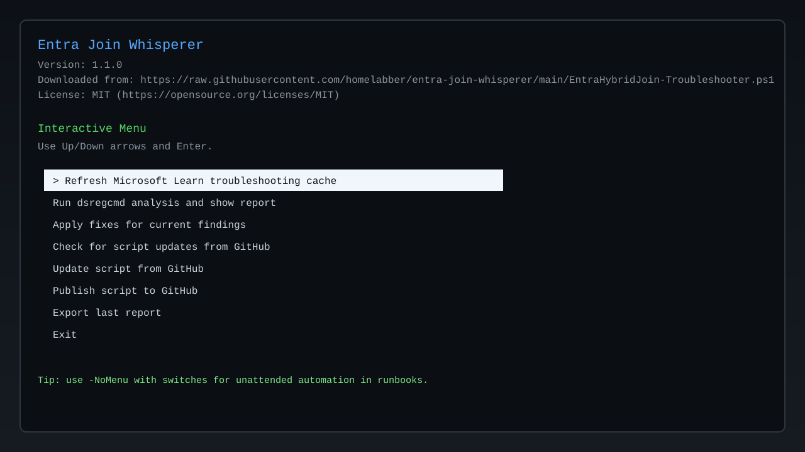

# Entra Join Whisperer

*Because `dsregcmd /status` tells the truth, but not always the whole story.*

Entra Join Whisperer is a PowerShell troubleshooting assistant for Microsoft Entra hybrid join issues. It analyzes `dsregcmd /status`, maps findings to Microsoft Learn guidance, suggests safer remediations first, and warns clearly before risky actions.



## What it does

- Pulls and caches troubleshooting guidance from Microsoft Learn.
- Parses `dsregcmd /status` output into actionable findings.
- Produces a readable issue report with evidence and fix guidance.
- Offers optional auto-remediation with risk prompts.
- Supports both an interactive light-bar menu and CLI automation switches.
- Can self-update from GitHub and publish to GitHub.

## Microsoft Learn sources used

- https://learn.microsoft.com/en-us/entra/identity/devices/troubleshoot-hybrid-join-windows-current
- https://learn.microsoft.com/en-us/entra/identity/devices/troubleshoot-intermittent-status-account-disabled
- https://learn.microsoft.com/en-us/troubleshoot/entra/entra-id/dir-dmns-obj/pending-devices
- https://learn.microsoft.com/en-us/entra/identity/devices/troubleshoot-device-dsregcmd

## Requirements

- Windows PowerShell 5.1+ or PowerShell 7+
- Windows device with `dsregcmd` available
- Local admin rights recommended for some repair actions
- Internet access for Learn refresh and self-update

## Quick start

```powershell
.\EntraHybridJoin-Troubleshooter.ps1
```

## Command-line options

| Option | Type | What it does |
|---|---|---|
| `-NoMenu` | Switch | Bypasses the interactive light-bar menu. |
| `-RefreshLearn` | Switch | Re-downloads Microsoft Learn troubleshooting pages into local cache. |
| `-Analyze` | Switch | Runs `dsregcmd /status` analysis and prints findings + guidance. |
| `-ApplyFixes` | Switch | Offers/applies fix actions for detected findings. |
| `-FixIds <id1,id2>` | String[] | Applies only specific fix IDs (example: `refresh-prt,run-device-join-task`). |
| `-ExportReport` | Switch | Exports the latest analysis report to file. |
| `-ReportPath <path>` | String | Sets report output path. Defaults to timestamped file in script folder. |
| `-JsonReport` | Switch | Exports report in JSON instead of text. |
| `-Force` | Switch | Skips interactive confirmation prompts for fixes/update. |
| `-CheckUpdate` | Switch | Checks GitHub for a newer script version. |
| `-UpdateSelf` | Switch | Replaces the local script with the latest GitHub version. |
| `-PublishToGitHub` | Switch | Publishes script and license to a GitHub repository. |
| `-GitHubRepoUrl <url>` | String | Target repo URL (for publish). |
| `-GitHubBranch <name>` | String | Target branch for publish. Default: `main`. |
| `-GitHubToken <token>` | String | Personal access token for authenticated publish. |

## Common examples

```powershell
# Refresh Learn cache and analyze
.\EntraHybridJoin-Troubleshooter.ps1 -NoMenu -RefreshLearn -Analyze

# Analyze and export text report
.\EntraHybridJoin-Troubleshooter.ps1 -NoMenu -Analyze -ExportReport -ReportPath C:\Temp\entra-report.txt

# Analyze and export JSON report
.\EntraHybridJoin-Troubleshooter.ps1 -NoMenu -Analyze -ExportReport -JsonReport -ReportPath C:\Temp\entra-report.json

# Apply only specific fixes
.\EntraHybridJoin-Troubleshooter.ps1 -NoMenu -Analyze -ApplyFixes -FixIds refresh-prt,run-device-join-task

# Check for updates
.\EntraHybridJoin-Troubleshooter.ps1 -NoMenu -CheckUpdate

# Self-update from GitHub source
.\EntraHybridJoin-Troubleshooter.ps1 -NoMenu -UpdateSelf
```

## Auto-fix safety model

The script warns before each fix and labels risk levels:

- **Low risk:** token refresh / scheduled task retry
- **Medium risk:** sign-out/reboot workflows, Kerberos purge, policy refresh
- **High risk:** leave-and-rejoin registration operations (`dsregcmd /debug /leave`)

If in doubt, export a report first and review with your identity team.

## License

MIT — see [LICENSE](LICENSE).

